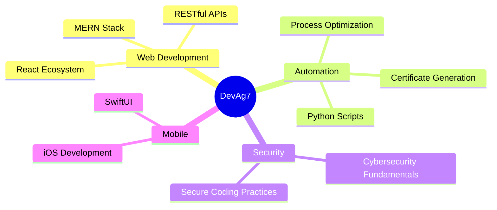

<div align="center">

```ascii
╔══════════════════════════════════════════════════════════════╗
║                                                              ║
║   ██████╗ ███████╗██╗   ██╗ █████╗  ██████╗ ███████╗        ║
║   ██╔══██╗██╔════╝██║   ██║██╔══██╗██╔════╝ ╚════██║        ║
║   ██║  ██║█████╗  ██║   ██║███████║██║  ███╗    ██╔╝        ║
║   ██║  ██║██╔══╝  ╚██╗ ██╔╝██╔══██║██║   ██║   ██╔╝         ║
║   ██████╔╝███████╗ ╚████╔╝ ██║  ██║╚██████╔╝   ██║          ║
║   ╚═════╝ ╚══════╝  ╚═══╝  ╚═╝  ╚═╝ ╚═════╝    ╚═╝          ║
║                                                              ║
╚══════════════════════════════════════════════════════════════╝
```


</div>

---

## 🚀 **Mission Control Dashboard**

```javascript
const developer = {
    name: "Dev Agarwal",
    currentMission: "Building scalable web applications",
    location: "India 🇮🇳",
    status: "Ready for deployment",
    
    skills: {
        frontend: ["React", "JavaScript", "HTML5", "CSS3", "SwiftUI"],
        backend: ["Node.js", "Express", "Python", "RESTful APIs"],
        database: ["MongoDB", "MySQL"],
        tools: ["Git", "Docker", "Vercel", "AWS"],
        currentlyLearning: ["Cybersecurity", "SwiftUI", "Advanced React Patterns"]
    },
    
    workingOn: () => {
        return [
            "🏏 Cricket Service Landing Page",
            "🍕 Food Delivery Platform", 
            "📜 Certificate Generation System",
            "🏠 Rental Management Solutions"
        ];
    },
    
    funFact: "I might be coding while you're reading this... or sleeping 😴"
};
```

---

## 🛰️ **Technology Radar**

<div align="center">

### **Current Stack**


### **Learning & Exploring**


</div>

---

## 📊 **Performance Metrics**

<div align="center">


<br/>


</div>

---

## 🎯 **Active Projects**

<table>
<tr>
<td width="50%">

### 🏏 Cricket Service Platform
*Revolutionary cricket booking system*
- **Tech Stack**: React, Node.js, MongoDB
- **Status**: 🚀 Live on Vercel
- **Impact**: Streamlining cricket facility bookings

[**→ View Live Demo**](https://cric-service-landing.vercel.app)

</td>
<td width="50%">

### 📜 Certificate Generator
*Automated PDF certificate creation*
- **Tech Stack**: Python, PIL, ReportLab
- **Status**: ⭐ 1 Star, MIT Licensed
- **Impact**: Automating certificate workflows

[**→ Explore Code**](https://github.com/devag7/certificate_generator_py)

</td>
</tr>
<tr>
<td width="50%">

### 🏠 RentWise Platform
*Full-stack rental management solution*
- **Tech Stack**: MERN Stack
- **Status**: 🔨 In Development
- **Impact**: Simplifying rental processes

</td>
<td width="50%">

### 📄 Resume Analyzer
*AI-powered resume optimization*
- **Tech Stack**: JavaScript, Node.js
- **Status**: 🎯 Active Development
- **Impact**: Career enhancement tool

</td>
</tr>
</table>

---

## 💡 **Innovation Lab**



---

## 🔥 **GitHub Activity Graph**

<div align="center">

[](https://github.com/devag7)

</div>

---

## 🎮 **Achievement Unlocked**

<div align="center">

| 🏆 **Achievement** | 📈 **Level** | 🎯 **Status** |
|-------------------|-------------|--------------|
| Code Commits |  | Master |
| Project Completion |  | Expert |
| Learning Progress |  | Legendary |
| Coffee Consumption |  | ∞ |

</div>

---

## 🌐 **Connect & Collaborate**

<div align="center">

```bash
# Clone my expertise
git clone https://github.com/devag7

# Initialize collaboration
npm install teamwork

# Push boundaries together
git push origin innovation
```

<br/>

[](mailto:devagarwalla2016@gmail.com)
[](https://linkedin.com/in/devag7)
[](https://github.com/devag7?tab=repositories)

</div>

---

## 📈 **Real-time Stats**

<div align="center">

**⚡ Quick Stats**
```
📦 17+ Repositories Created
🔥 Regular Contribution Streak
🌟 Open Source Contributor
🎯 MERN Stack Specialist
```

**🔍 Repository Highlights**
- 🏏 Cricket Service: Live production app
- 📜 Certificate Generator: 1⭐ Python automation
- 🏠 RentWise: Full-stack rental platform
- 📄 Resume Checker: AI-powered analysis tool

*[View all 17 repositories →](https://github.com/devag7?tab=repositories)*

</div>

---

<div align="center">

### 💭 **Daily Motivation**

*"Code is like humor. When you have to explain it, it's bad."* – Cory House

```
while (alive) {
    eat();
    sleep();
    code();
    repeat();
}
```

**🚀 Ready to build something amazing together?**

</div>

---


